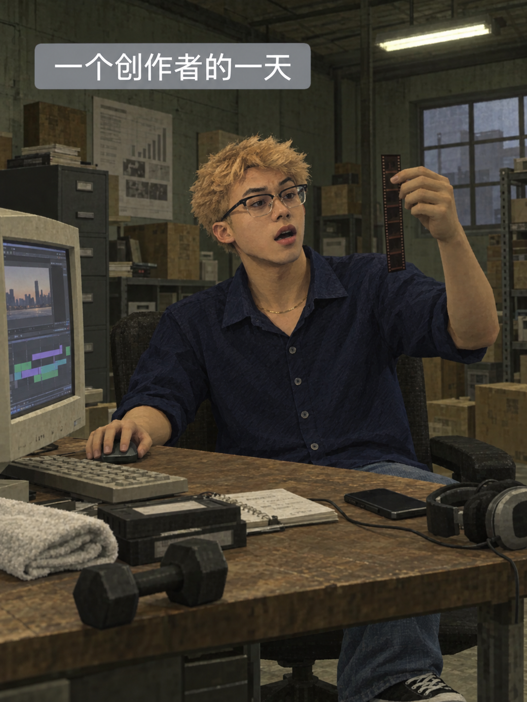

# 我的一天 · 旧游戏图鉴

**Day as Game** — 用约六个问题，把你的一天变成一张封面和六张自然旧3D游戏风日常图。



**画风就按上面这张原图。**仓库保留用户明确选定的原始文件，每次生图都以它作风格参考，不自行粗化脸部、改成三角发片或生成另一张图替代。支持默认游戏人物，也支持上传照片或插画头像定制同一主角；更换人物不等于更换画风。

## 安装

在具备图像生成能力的 Codex 环境中，将本仓库作为 `day-as-game` 文件夹放入技能目录。例如目录尚不存在时：

```bash
git clone https://github.com/gerrywrittenhousea76-design/day-as-game.git ~/.codex/skills/day-as-game
```

已有安装时保留自己的修改，再更新对应文件。重新打开聊天后调用：

```text
用 $day-as-game 画我的一天。先问我男性还是女性，让我选择默认人物或上传照片／头像，再通过约六个问题了解我的日常，生成一张封面和六张日常图。
```

也可下载仓库ZIP，解压并将含有 `SKILL.md` 的目录命名为 `day-as-game`，放入支持的技能目录。

## 六问与输出

六问覆盖：性别、人物定制、早晨、白天工作、特点与情绪、傍晚与夜间。已回答的信息不会重复询问；性别不推断，得到明确答复后才生图。需要附图时在聊天上传即可。

默认输出7张独立3:4竖图、逐张最终提示词和简短验收说明。用户可指定数量与比例。封面锁定人物，后续图片沿用相同角色与画质。

## 文件

- [SKILL.md](SKILL.md)：六问流程、人物定制、生成与验收。
- [风格规范](references/style-bible.md)：脸、头发、场景、材质、构图与标题。
- [提示词模板](references/prompt-template.md)：可独立使用的生图和返修提示词。
- [原图生成提示词](references/original-generation-prompt.txt)：选定原图的实际生成提示词记录。
- [assets/style-reference.png](assets/style-reference.png)：用户选定的固定原图，不作二次编辑或替换。

## 验证范围

已完成Skill结构、文件链接、固定参考原图的尺寸与SHA-256一致性检查。开发时实际跑通过默认人物生图和上传插画人物形象的系列定制；最终画风由用户选回本仓库中的固定原图。女性分支与真人照片相似度尚未单独测试。

需要实际图像生成工具。没有工具时可使用提示词模板，但不能把提示词交付称为完成出图。生成具有随机性，参考图与提示词用于复用画风，不保证逐像素一致。

## 开源

采用 [MIT License](LICENSE)。欢迎提交Issue或Pull Request改进提示词和工作流。仓库包含用户明确选定的这张AI生成风格图；最初上传的头像素材与第三方原始参考图不包含在仓库中。

Maintained by [JEFF Jiang](https://github.com/gerrywrittenhousea76-design).
